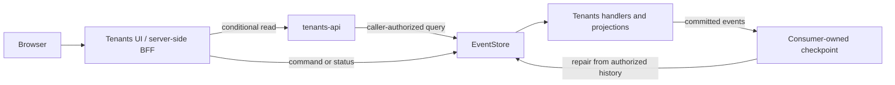

# Architecture Decision Document

**Approved McpCli course correction (2026-09-27):** `Hexalith.McpCli` is the target Hexalith-owned CLI/MCP surface for Tenants operations that pass contract enrollment and authorization. Any proprietary module CLI, MCP host, plug-in, or planned adapter described below is an obsolete migration source or historical design, not a new target. The module retains its domain, UI, and security semantics; replacement or approved withdrawal and parity evidence precede retirement. External development CLIs are unaffected.


## Canonical Architecture Spine

AD-1 through AD-15 govern Tenants UI composition and its contracts with the public API, the domain and downstream services. The November update incorporates the approved audit and the revised PRD. The [decision log](architecture/architecture-tenants-2026-11-20/.memlog.md) continues the [archived architecture run](../archive/planning-artifacts/architecture-tenants-2026-06-25/.memlog.md).

### Design Paradigm

Tenants Management UI is a **FrontComposer-composed domain UI**: FrontComposer owns shell, page chrome, domain registration, and reusable UI primitives; Tenants owns tenant-domain surfaces, domain state vocabulary, server-side gateway composition, and support-safe user-facing domain copy. The event-sourced backend is inherited context rather than a second UI architecture.

### AD-1 - Tenants Is One FrontComposer Module Entry [ADOPTED]

- **Binds:** FR-1..FR-4, FR-18..FR-21, Operations Shell IA.
- **Prevents:** independently-built surfaces registering separate shell entries for All Tenants, My Tenants, Users, Global Administrators, or Audit.
- **Rule:** Tenants contributes exactly one shell navigation entry at `/tenants`; Tenants-domain sub-surfaces live as page-local tabs, scope modes, aliases, or contextual links inside the module workspace.

### AD-2 - Page-Local Tabs Own Tenants Sub-Surface Switching [ADOPTED]

- **Binds:** `/tenants`, `/tenants/my`, `/tenants/users`, tenant detail, global-administrator, and audit return flows.
- **Prevents:** shell navigation, route aliases, and return links from encoding incompatible information architecture.
- **Rule:** Register one shell entry at `/tenants`. Generate `/tenants/tenants` for All Tenants and My Tenants (`scope=mine`) and `/tenants/workspace-users` for user lookup. Honor legacy entry and tab aliases, including `/tenants/my` and `/tenants/users`. Normalize query state per surface and reset paging when its scope, filter, sort or page size changes. Ordinary list, My Tenants and lookup URLs may carry an opaque cursor. Search and search-fallback continuations stay in the circuit. Strip protected continuations from contextual audit return links. Detail, audit and global administration are contextual routes. Enable a tenant audit link only for an explicit, safe tenant with reliable current scope and authority and available audit-read capability. Tenant, date and category constrain the tenant audit query. User and command origins supply context hints and cannot establish exhaustive matches or command proof. [Workspace state](../../src/Hexalith.Tenants.UI/State/TenantList/TenantWorkspaceState.cs)

### AD-3 - FrontComposer And Fluent Are The First UI Composition Surface [ADOPTED]

- **Binds:** all Razor components, UX-DR1..UX-DR33, and Fluent conformance tests.
- **Prevents:** raw interactive controls, duplicate page chrome, theme redefinition, and Tenants-owned generic UI infrastructure.
- **Rule:** use FrontComposer or Fluent UI Blazor V5 components before custom markup; custom CSS or raw semantic markup is allowed only for documented gaps not covered by FrontComposer or Fluent.

### AD-4 - Tenants Owns Domain Composition, Not Generic UI Infrastructure [ADOPTED]

- **Binds:** `Components/Tenants`, `Components/Users`, `State`, `Services`, and `Resources`.
- **Prevents:** generic grids, tabs, shell layout, theme primitives, or reusable command chrome being implemented inside Tenants.
- **Rule:** Tenants-specific components may encode tenant safety, freshness, audit, support-safety, and command behavior; reusable UI capability is a FrontComposer change or an approved fallback.

### AD-5 - Server-Side Gateways Are The Only Backend Egress [ADOPTED]

- **Binds:** query surfaces, command flows, auth token relay, and Memories search hydration.
- **Prevents:** browser-side backend calls, token exposure, component-to-HTTP coupling, and multiple transport paths for the same data.
- **Rule:** UI components never call Tenants, EventStore, or Memories directly; backend egress goes through `ITenantQueryGateway`, `ITenantCommandGateway`, and their server-side collaborators.

### AD-6 - Direct Tenants REST Reads Are The Read Transport [ADOPTED]

- **Binds:** FR-1..FR-9, FR-18, FR-20..FR-23, NFR-1, and NFR-3.
- **Prevents:** routing tenant reads through the EventStore generic query gateway or retired projection-actor paths that drop projection metadata.
- **Rule:** The server-side BFF sends caller-authorized reads to the generated `tenants-api` REST surface. Generated REST responses use camelCase JSON. The API forwards internally through EventStore to the Tenants handler. The BFF uses a separate EventStore client for command submission and status. Single-tenant detail, roster and audit use the canonical tenant in the route. Tenant list, user memberships and governance audit use `platform:tenants`. The administrator list and governance commands use `platform:global-administrators`. The catalog governs permissions and the domain verifies membership or persisted authority. [Public scope contract](../../docs/production-auth-claim-contract.md) · [Route catalog](../../src/Hexalith.Tenants.Contracts/Routing/TenantCatalogDeclarations.cs)
- **Roster existence:** Until successful creation, including rejection-only history, the handler returns missing for a global administrator and forbidden for an ordinary caller. Only an authorized read of a created tenant can return a successful empty roster. [Roster handler](../../src/Hexalith.Tenants/Queries/Handlers/GetTenantUsersQueryHandler.cs)

### AD-7 - Projection-Confirmed Truth Is Shared Composition State [ADOPTED]

- **Binds:** truth badges, command lifecycle panels, list/detail/member/audit/global-administrator surfaces, and command flows.
- **Prevents:** optimistic success, per-surface state vocabularies, and collapsing `accepted`, `confirmed`, and `audit available`.
- **Rule:** Every actionable surface uses shared truth, freshness, lifecycle, audit and authorization types. SignalR and status can trigger a projection re-query. AD-12 defines what confirms a command.
- **Audit availability.** `Available` requires a complete, support-safe receipt matched to the attempt. `Pending`, `Delayed`, `Unavailable` and `MissingSupport` describe distinct outcomes without verified proof. Render command confirmation independently. [Audit availability enum](../../src/Hexalith.Tenants.UI/State/TenantAudit/TenantAuditAvailabilityState.cs)
- **Tenant list.** `TenantListSurfaceKind` governs the list presentation. Show access denial, an empty authorized list, an empty filtered list and a search page without visible authorized hits as distinct outcomes. [List enum](../../src/Hexalith.Tenants.UI/State/TenantList/TenantListSurfaceKind.cs) · [Shared presentation](../../src/Hexalith.Tenants.UI/Components/Shared/ListSurfaceStates.razor)

### AD-8 - Freshness Comes From EventStore Read-Model Metadata [ADOPTED]

- **Binds:** action availability, list states, badges, and stale/degraded behavior.
- **Prevents:** duplicate Tenants freshness enums, `ServedAt` as projection age, search results as freshness proof, or 304 responses being treated as recovery without metadata.
- **Rule:** The BFF evaluates projection-backed provenance on each 200 and 304. Reuse cached data on 304 only for the same authorized request with a matching strong validator, usable projection version and supported freshness metadata. A valid 304 can still be stale. Missing, contradictory or degraded evidence cannot authorize a high-impact action. `ServedAt` is response time. `Refreshing` is UI-only. First creation allows unknown freshness only for a verified global administrator viewing an authoritatively empty first tenant list with no first-write timestamp. [REST client](../../src/Hexalith.Tenants.UI/Services/Gateways/TenantsRestQueryClient.cs)

### AD-9 - Domain Copy And Support Safety Stay Tenants-Owned [ADOPTED]

- **Binds:** receipts, consequence previews, rejection text, copy actions, and resource files.
- **Prevents:** shell-owned domain wording, fragment-assembled localization, and unsafe data leaking into rendered output.
- **Rule:** Tenants owns whole-string localized domain copy. Parameterized resources use indexed .NET composite formatting, with the same meaning for each argument index in every culture. A copy control receives only the exact value and identifier kind positively approved by its authorized surface. The BFF maps receipts and previews to support-safe fields before display. The PRD requires proof-only fields to stay outside rendered components. The server-side grid currently receives internal correlation and sequence fields. Keep that conformance finding open. [PRD validation](prds/prd-tenants-2026-06-02/validation-report.md)
- **Configuration:** Apply deployment display policy in the BFF before browser-facing composition. Every key must match the exact display-safe set. Ordinary callers also require an ordinal prefix grant. Administrators bypass only the prefix check. Missing or malformed policy withholds configuration for everyone. The authorized API preserves the full consumer contract. [Configuration read policy](../../docs/tenant-configuration-read-policy.md)

### AD-10 - Memories Is Search-As-Index-Only [ADOPTED]

- **Binds:** FR-1 cross-set tenant search and tenant-list search states.
- **Prevents:** adding a Tenants/EventStore list-filter endpoint, rendering row truth from Memories, or blocking the tenant list on search outage.
- **Rule:** Memories supplies candidate tenant IDs. The BFF deduplicates, reads each eligible row from Tenants under caller authority and sorts the visible page deterministically. Fill the page and require one additional authorized row before enabling Next. Each load may examine up to 1,000 raw positions, including replay and lookahead. Reaching the budget without resolving the page or encountering an operational hydration gap discards the partial search and shows the labelled authorized-list fallback. Missing, forbidden and filtered hits reveal no paging signal.
- **Index maintenance.** Only the sample host registers `MemoriesSearchIndexEventPublisher` for `TenantCreated`, `TenantUpdated`, `TenantDisabled` and `TenantEnabled`. It publishes `SearchIndexEntryChanged` to `memories-events` as an upsert keyed by `(tenants-index, tenantId)`. Each search-enabled deployment owner must connect these lifecycle events to an active publisher and verify that a created tenant and its subsequent rename reach the index and appear through authorized BFF search. AppHost can start Memories independently of the sample. A reachable but stale index can omit candidates. [Sample registration](../../samples/Hexalith.Tenants.Sample/Program.cs) · [Publisher](../../samples/Hexalith.Tenants.Sample/Handlers/MemoriesSearchIndexEventPublisher.cs) · [AppHost composition](../../src/Hexalith.Tenants.AppHost/Program.cs)
- **Continuation:** Protect the fixed-window start and consumed-result count with the platform cursor codec. Bind it to caller, index, normalized search, status, sort, direction and page size. Replay a partial window from its fixed start. Keep continuations server-side and restart at page one with notice on invalidation. The index can change between pages. The privacy bound covers rendered rows and pager for equal authorized results within budget. [Read-safety decision](../implementation-artifacts/dw-117-118-127-599-618-validation-evidence.md)

### AD-11 - UI Conformance Tests Are Architectural Guardrails [ADOPTED]

- **Binds:** UI tests, route smoke tests, localization parity, selector stability, and support safety.
- **Prevents:** accidental drift from FrontComposer/Fluent composition, raw controls, unsupported routes, or unsafe rendered output.
- **Rule:** every UI surface change updates focused bUnit/conformance coverage; guards are not loosened without an explicit approved story.

### AD-12 - Command Flows Share One FrontComposer Command Posture [ADOPTED]

- **Binds:** FR-10..FR-17, FR-19, FR-24..FR-25, and CP-2..CP-8.
- **Prevents:** independent command flows choosing optimistic success, concurrent submits, bulk action, toast batching, or bypassing preview and gating.
- **Rule:** Tenants admits one active command per interactive circuit and aggregate. FrontComposer supplies the shared controls. Hold the lease through submission, projection pending and an unverifiable outstanding attempt. Other aggregates may proceed. Grant controls use the same eligibility rules for rendering, dispatch and delivery retry.
- **Confirmation.** Require the command-specific postcondition on an authoritative read and qualifying evidence beyond the pre-submit baseline. Use `already applied` only when the operation explicitly defines that outcome and authoritative evidence establishes it. Examples include an authorized same-role NoOp and a `UserNotInTenant` removal rejection followed by a fresh read proving the target is absent. Both describe the observed state without attributing a change to this attempt. `UpdateTenant` emits `TenantUpdated` even for identical metadata. If the submitted values already matched the baseline, confirmation requires matching tenant detail and qualifying audit evidence attributable to this attempt. Without that audit evidence, matching values and an unrelated version advance leave the outcome `unable to verify`. [Metadata confirmation](../../src/Hexalith.Tenants.UI/State/TenantCommands/TenantUpdateMetadataCommandSnapshot.cs) · [Same-value regression cases](../../tests/Hexalith.Tenants.UI.Tests/State/TenantUpdateMetadataCommandSnapshotTests.cs) · [Removal rejection and re-query](../../tests/Hexalith.Tenants.UI.Tests/State/TenantRemoveMemberCommandSnapshotTests.cs)
- **High-impact actions.** Before opening the preview, dispatching or retrying delivery, recheck caller authority, projection freshness under AD-8, input validity, required gateway capabilities, circuit and aggregate admission, and a measured viewport that can show the complete safety context. At dispatch and retry, also match the reviewed preview to the current target and consequences. Phone layouts are read-only for these actions. An unknown or unsafe measurement, including after resize, blocks the write and displays the reason. Authorized read-only triage and status lookup remain available. [Responsive requirements](prds/prd-tenants-2026-06-02/prd.md) · [Member removal](../../src/Hexalith.Tenants.UI/Components/Tenants/Members/RemoveTenantMemberFlow.razor) · [Administrator controls](../../src/Hexalith.Tenants.UI/Components/Pages/GlobalAdministratorsPage.razor)
- **Recovery:** First-member bootstrap requires an active tenant with no prior membership. Restoring an owner on a previously populated, ownerless tenant requires a global administrator. Removing the last tenant owner carries a warning and additional confirmation. Domain rules prohibit removing the last global administrator.
- **Proof:** For a correction, verify the exact attempt and its committed sequence. Confirm only when a fresh, ordered projection of the same aggregate reaches or exceeds that sequence and shows the intended effect. Keep the original receipt. Tenant correction reports `MissingSupport` for pairing and clears the pair. Governance may link two receipts only after reauthorization in the originating circuit and independent protected evidence for the source and corrective attempt. For member removal, show the tenant, target and current role with the other seven [required preview facts](../../docs/tenants-ui-remove-user-from-tenant-journey-spec.md#21-preview-content-enumerated-exactly). Require proof capability before dispatch and stable, complete evidence for the exact attempt and sequence before exposing the receipt. A confirmed local change can outlive an inconclusive audit read. [Correction contracts and acceptance](prds/prd-tenants-2026-06-02/prd.md)

### AD-13 - The UI Host Is Domain-Owned; Orchestration Is Platform-Owned [ADOPTED]

- **Binds:** deployment, local orchestration, auth/service references, and containerization.
- **Prevents:** moving Tenants domain UI into FrontComposer, shipping it as a NuGet package, adding Dockerfiles, expanding a repository-owned AppHost/Aspire surface, or duplicating shared hosting and ServiceDefaults infrastructure.
- **Rule:** `src/Hexalith.Tenants.UI` is a publishable app/container owned by this repository; distributed orchestration belongs to a platform/composing host. The existing `src/Hexalith.Tenants.AppHost` is transitional legacy to migrate or remove and must not gain shared hosting plumbing.

### AD-14 - Production Operations And Scaling Are Platform-Governed [ADOPTED]

- **Binds:** NFR-1..NFR-5, container deployment, configuration, secrets, health, telemetry, and replica count.
- **Prevents:** embedding secrets, treating UI memory as durable truth, shipping bespoke observability, or scaling InteractiveServer with incompatible key/session/cursor assumptions.
- **Rule:** externalize configuration and secrets; consume shared health, telemetry, and non-root SDK-container defaults; keep persistent truth outside the UI host; and do not scale InteractiveServer beyond one replica until shared DataProtection, circuit/session routing, and cursor durability are verified. Both public REST and domain hosts require valid Production OIDC at startup. Release evidence covers cold bootstrap, persisted state, authenticated REST and authenticated UI on one revision with its shipping packages.

### AD-15 - Downstream Access Requires a Verified Consumer Checkpoint [ADOPTED]

- **Binds:** FR-12, NFR-2 and NFR-3, access-enforcing subscribers and membership revocation.
- **Prevents:** a consumer granting protected access from an incomplete history after a delayed removal or restart.
- **Rule:** Each enforcing consumer reads a durable, shared, consumer-owned checkpoint for the tenant. On a sequence gap, withhold usable state, recover from authorized stream history and persist recovered state and sequence together with optimistic concurrency. Commit only contiguous progress. On a conflicting write, reload and retry without regressing the sequence. Acknowledge a delivery only after its outcome is durable. Check the authenticated subject and required role against a healthy snapshot of an active tenant. If the snapshot is unavailable or behind a known required sequence, deny or defer protected work. A healthy snapshot covers the observed prefix. Local UI confirmation describes Tenants only. The sample's membership and configuration readouts are Development-only. [Consumer integration contract](../../docs/idempotent-event-processing.md)

### Conformance and qualification, 20 November 2026

The direct REST client and protected search cursor implement the July transport and paging decisions. Platform ownership of orchestration remains the target. The repository AppHost still composes the local topology. The standalone UI still lacks shared health and OpenTelemetry wiring. Keep it single-replica pending verified shared Data Protection, circuit routing and cursor durability.

Both the public REST and domain hosts validate Production OIDC before serving. Require an HTTPS authority and discovery, expected issuer and audience, and an explicit asymmetric signing algorithm. Development signing keys are refused in Production. The UI host uses server-side OIDC sign-in and relays the caller's token. [Production authentication settings](../../docs/production-auth-readiness.md)

| Open check | Owner | Evidence required |
| --- | --- | --- |
| Hosted release qualification | Release owner | Exercise cold bootstrap, persisted state, authenticated REST and authenticated UI on the same candidate revision and shipping package set. Local manifest checks identified EventStore.Contracts 5.4.0 and McpCli.Abstractions 3.0.0. |
| First access-enforcing consumer | Consumer deployment owner | Demonstrate authorized history access, durable shared state and correct access after a delayed removal and restart. |
| Deployed identity | Deployment owner | Verify real issuer, audience, discovery TLS, ingress and key rotation. Record redacted evidence. |
| Tenant-index capacity | Deployment owner | Measure index size, write contention and update latency at representative load. Preserve the same index version for equivalent replayed state. Revisit partitioning when deployed measurements justify it. |

The September audit-grid reference run passed for 500 entries and 50-row pages. The approved p75/p95 budgets are 2.5/4.0 seconds for initial render, 1.5/3.0 seconds for results and 200/500 milliseconds for feedback. Qualify the release candidate on the dedicated environment and repeat after relevant audit query, BFF, grid or paging changes. The audit-grid result and tenant-index capacity check measure different workloads. [Performance contract](../implementation-artifacts/story-5-1-performance-decision.md) · [November audit](sprint-change-proposal-2026-11-20.md) · [Open owner checks](../implementation-artifacts/sprint-status.yaml)

### Deferred Decisions

- Complete all-users inventory only after an authorization-scoped backend query exists.
- Replace approved fallbacks when FrontComposer ships reusable equivalents.
- Expose freshness `aging` only when EventStore provides the necessary projection metadata on the wire.
- Revisit multi-replica cursor durability when shared DataProtection/cursor durability lands.
- Remove the repository-owned AppHost when a platform/composing host owns the full Tenants topology.
- Reconcile `_bmad-output/project-context.md` with AD-13 and the governing domain-module boundary in a separately authorized project-context update.
- Claim RTL/WCAG 2.2 only after the pinned Fluent/FrontComposer behavior is verified.
- Any future sensitive-value reveal needs its own approval and audited display policy. AD-9 governs current configuration display.

## Project Context Analysis

### Requirements Overview

**Functional Requirements — 25 FRs across 9 feature groups, in 3 build phases.**
The PRD defines FR-1..FR-25 as **UI composition over an already-built event-sourced
backend** (no backend endpoints, no contract reshaping). They collapse into two
construction patterns:
- **Read/projection surfaces** (FR-1..FR-9, FR-18; audit-read FR-20..FR-23) — compose
  six REST read categories through the FrontComposer/DataGrid composition: cursor
  pagination (never offset/limit), conditional ETag reads with verified freshness, and authorization-scoped results.
  Phase 2a was the original read-only milestone. Later phases delivered permission-gated commands.
- **Custom command flows** (FR-10..FR-17, FR-19, FR-24..FR-25) — *not generated CRUD*;
  each dispatches `POST /api/v1/commands` and tracks an async
  `accepted → projection-confirmed → audit-available` lifecycle, with server-side BFF-assembled
  Consequence Previews and Audit Evidence Receipts (no new backend endpoints).
Phasing: **2a/MVP** (read: FR-1..9, FR-18) → **2b** (first commands: FR-10/11/13/14)
→ **2c** (high-impact + audit + recovery: FR-12/15/16/17/19/20–25). Epic 5 now provides
backing stories for FR-20..FR-25, including the flat audit DataGrid, support-safe receipts,
audit availability, tenant correction and independently verified governance proof (AD-12). Epic 4
Stories 4.2 and 4.3 now provide FR-19 global-administrator grant/remove command support in the
fixed `global-administrators` scope.

**Non-Functional Requirements — the honesty contract is the architecture driver.**
- **NFR-3 Reliability/consistency (defining):** eventually-consistent, event-sourced;
  projection is the source of truth; correct under at-least-once delivery + projection
  lag; under Blazor InteractiveServer the UI re-derives truth from server-side BFF reads and
  never resurrects optimistic success.
- **NFR-2 Security/authorization:** server-enforced at API (L1) + domain RBAC (L2); the
  UI **reflects, never enforces**, and must stay safe even if it misjudges; role-scoping
  derived from authenticated scope, operation permissions and authoritative membership or governance state.
- **NFR-1 Performance/freshness:** cursor pagination + conditional requests (ETag/304);
  the approximately one-second warm tenant-read target is provisional. The September audit-specific budgets and candidate qualification are recorded above.
- **NFR-4 Observability/testability:** stable automation selectors/component contracts —
  never keyed on row text or color.
- **NFR-5 No data-store edits:** corrections are forward compensating commands only.
On top sits the **CP-1..CP-10 interaction contract** (five truth dimensions, fail-closed
gating, non-collapse invariant, SignalR-nudge-only, consequence-preview-before-
destruction, asymmetric high-risk, correct-forward-never-undo, canonical-vocabulary-
verbatim) — translating directly into a **shared typed UI truth-state model**.

**Scale & Complexity:**
- Primary domain: **Web frontend** — a Blazor InteractiveServer domain UI composed on the
  **Hexalith.FrontComposer** shell, consuming an event-sourced CQRS backend over
  REST + DAPR/SignalR. .NET 11 and Fluent UI Blazor 5.1.0.
- Complexity level: **HIGH.** Drivers: eventual-consistency correctness as the core
  thesis; a 5-dimension truth-state model with casing-significant canonical vocabularies
  for badges, lifecycle, feedback, reasons, freshness and audit (AD-7) and a strict
  non-collapse invariant; role-scoped multi-tenant authorization reflection; a heavy,
  partly-missing external dependency (FrontComposer) gating even the MVP; first-class
  a11y/l10n/responsive-fail-closed; hard support-safety rules.
- Implemented architectural surface: the **Blazor InteractiveServer UI host** plus shell
  composition, query and command gateways, typed lifecycle/truth snapshots,
  authorization reflection, localization, and domain UI components over FrontComposer.

### Technical Constraints & Dependencies

- **Consume-only backend (fixed):** six read categories (`GET /api/tenants`,
  `/api/tenants/{tenantId}`, `/api/tenants/{tenantId}/users`, `/api/users/{userId}/tenants`,
  `/api/tenants/{tenantId}/audit`, `/api/global-administrators`, with governance audit at `/api/global-administrators/audit`) + `POST /api/v1/commands` +
  `GET /api/v1/commands/status/{messageId}`. No new endpoints; receipts/previews/
  status, receipts, and previews assembled server-side in the BFF from safe read-model fields.
- **FrontComposer owns shared UI.** Per repo domain-
  boundary policy, missing shared UI capability belongs in FrontComposer, not Tenants.
  The June 5 Story 1.0 spike recorded that `FC-LYT`, `FC-CMD`,
  `FC-CNC`, `FC-A11Y`, `FC-L10N`, and `FC-DOC` had shared contracts; `FC-TBL` is available
  with a resolved Tenants boundary; `FC-AUD` and `FC-CNS` remain covered by Product/UX-approved fallbacks;
  `FC-TOK` remains a missing shared capability covered by Tenants' canonical vocabulary
  and verified Fluent semantic/icon mapping until a shared token contract exists. The
  FC-AUD/FC-CNS/FC-CNC fallbacks are Product/UX-approved (2026-06-03 - see the
  Fallback Approval Record, `fallback-approval-record-2026-06-03.md`). `FC-TBL` does
  not provide cursor pagination, safety-column pinning, or the distinct tenant-list
  presentations required by AD-7. Story 1.2 resolved the Epic 1 path by composing a Tenants-specific
  `TenantDataGrid` from Fluent/FrontComposer primitives while keeping generic reusable
  cursor/pinning/list-state capability as a FrontComposer concern.
- **Fluent UI Blazor 5.1.0** — exact token/component/ARIA names
  verified against the pinned package at build; none asserted available without check.
- **Build baseline, 20 November 2026.** Tenants targets `net11.0` with SDK 11.0.100, Aspire 17.0.0, EventStore 5.4.0 and McpCli 3.0.0. The pinned catalog defaults to FrontComposer 6.0.0 and Memories 4.0.0. The default build consumes packages. Source debugging is opt-in. Qualify the restored package set used for Release. [SDK](../../global.json) · [Tenants build properties](../../Directory.Build.props) · [Central package catalog](../../references/Hexalith.Builds/Props/Directory.Packages.props)
- **Identity.** Canonical public tenant IDs are 1–64 ASCII letters, digits or hyphens, with alphanumeric endpoints. Normalize to lowercase without trimming. User IDs retain their literal identity. Duplicate canonical grants, malformed grants and the reserved public tenant `system` fail closed. The client supplies the operation’s declared scope. The receiving service verifies it against the catalog. Internal stream identities stay private. [Identity and scope rules](../../docs/production-auth-claim-contract.md)

- **Async, eventually-consistent integration:** commands return `202` + correlationId;
  confirmation requires the command-specific evidence in AD-12. DAPR pub/sub is at-least-once;
  **SignalR projection notifications are freshness nudges only.**
- **Cursors:** opaque, protected and scope-bound (AD-2 and AD-10); multi-replica
  durability is an open backend gap (Epic 11) — UI must handle cursor invalidation.
- **Auth/claims:** Use the authenticated subject, catalog permissions, canonical tenant grants and persisted domain authority. A global-administrator role hint alone cannot grant access. Production bearer validation at both hosts follows AD-14.

- **Repo/build conventions:** `.slnx` only; central package versions; no copyright headers;
  `ConfigureAwait(false)`; xUnit v3 + Shouldly (+ bunit/Playwright); SDK containers (no
  Dockerfiles); Conventional Commits.
- **UI host placement — resolved by AD-13:** `src/Hexalith.Tenants.UI` is a domain
  presentation host owned by this repository. Distributed orchestration belongs to a
  platform/composing host; the existing repository AppHost is transitional and must not
  accumulate shared AppHost, Aspire, ServiceDefaults, or generic hosting capability.

### Cross-Cutting Concerns Identified

1. **Truth-state / honesty model (CP-1..CP-4)** — one shared client model behind every
   surface; never collapse `accepted`/`confirmed`/`audit available`; never show
   unconfirmed success.
2. **Authorization reflection (CP-9 / NFR-2)** — every actionable element reflects server
   auth, fail-closed; the UI is never the gate.
3. **Freshness & eventual consistency (NFR-3)** — ETag/304 + projection-as-truth + Blazor
   InteractiveServer circuit-reconnect re-derivation.
4. **Support-safety / privacy (§10)** — no tokens, payloads, correlation-ids, raw metadata,
   or PII in any surface/log/receipt/copy; safe localized rejection text only.
5. **Accessibility (WCAG 2.1 AA; conditional 2.2)** — no-color-only, live-region politeness
   (assertive reserved for failures), complete-or-exit every workflow; non-removable even
   under fallback.
6. **Localization** — Tenants owns whole-string domain resources with indexed composite-format arguments. FrontComposer owns shell copy (AD-9).
7. **Canonical state vocabularies (CP-10)** — verbatim, casing-significant; a single shared
   enumeration source across components.
8. **Command lifecycle & idempotency** — `messageId` idempotency key; async confirm;
   eligible retries reuse the message ID. Tenants enforces admission per circuit and aggregate (AD-12).
9. **FrontComposer dependency & fallback governance** — the build-readiness gate this
   architecture must convert into an actionable resolution + sequencing plan.
10. **Testability/automation (NFR-4)** — stable selectors/component contracts pervade all
    components.

## Starter Template Evaluation

### Primary Technology Domain

.NET 11 Blazor web application (interactive, server-rendered) — a domain UI composed on the
**Hexalith.FrontComposer** shell with **Microsoft Fluent UI Blazor v5**, consuming the existing
Tenants/EventStore REST + DAPR/SignalR backend. The implemented host is
`src/Hexalith.Tenants.UI`; the starter evaluation below is retained as decision history.

### Starter Options Considered

This is not a "pick a JS starter" decision; the ecosystem dictates the stack. Three
foundations were evaluated, grounded in the initialized submodules:

1. **New Blazor host composing the FrontComposer Shell** *(recommended)* — satisfies the PRD/UX
   "Operations Shell = FrontComposer shell" mandate and the repo domain-boundary policy (shared
   UI lives in FrontComposer, not Tenants). The Shell provides shell layout (FC-LYT), navigation
   from registered domain manifests, the projection DataGrid (FC-TBL), command dispatch, and
   theming. Typed Tenants state remains domain-owned under AD-4 and AD-7. FC-LYT readiness is closed.
2. **Standalone Fluent UI Blazor app, no FrontComposer Shell** (the `EventStore.Admin.UI`
   pattern) — technically viable, but contradicts the Operations-Shell requirement and the
   boundary policy; retained only as the **constrained fallback** if FC-LYT never resolves.
3. **Generic `dotnet new blazor`, no FrontComposer** — rejected; fails the composition mandate
   and would re-implement shared shell scaffolding inside Tenants.

The June selection used the EventStore InteractiveServer reference hosts and a prerelease Fluent build. The current Tenants host uses the catalog versions above. `Hexalith.FrontComposer.Cli` provides local inspect/migrate tooling. Operator capabilities require a decorated contract, enrollment and authorization in McpCli. Hard deletion is outside the UI and has no approved operator enrollment.

### Selected Starter: `src/Hexalith.Tenants.UI` Blazor host composing the FrontComposer Shell

**Rationale for Selection:**
It is the only foundation that satisfies the "Operations Shell within a FrontComposer shell"
requirement and the domain-boundary policy. Epic 1 reuses FrontComposer shell/layout contracts and
uses Tenants-specific read components where FC-TBL does not meet cursor/safety-state needs, while
inheriting Fluent v5 + theming + manifest-driven navigation instead of rebuilding them in Tenants.
The implementation mirrors the proven EventStore reference UIs for host bootstrap, auth, and
backend access. (Option 2 remains a historical fallback path.)

**Historical initialization command** *(the host is now implemented):*

```bash
# from repo root: create the Blazor Web App host, then wire FrontComposer + Fluent
dotnet new blazor -n Hexalith.Tenants.UI -o src/Hexalith.Tenants.UI \
  --interactivity Server -f net10.0
# then: add to Hexalith.Tenants.slnx; reference Tenants.Client (+ a ServiceDefaults);
# add FrontComposer.Shell + Fluent UI Blazor packages (versions via Directory.Packages.props);
# compose the shell in MainLayout and register the Tenants domain manifest.
```

> The implemented host uses Blazor InteractiveServer (`AddInteractiveServerComponents` and
> `AddInteractiveServerRenderMode`). No package versions go in `.csproj` files; versions stay in
> central `Directory.Packages.props`.

**Architectural Decisions Provided by Starter:**

**Language & Runtime:** C# / .NET 11 (`net11.0`, SDK `11.0.100`), `Microsoft.NET.Sdk.Web`;
Nullable + ImplicitUsings + `TreatWarningsAsErrors` + `ConfigureAwait(false)` per repo props.

**UI / Styling:** Microsoft Fluent UI Blazor v5 (`5.1.0`) from the central package catalog; semantic theme roles, no bespoke palette; Fluent type ramp /
shapes / elevation. Tenants references the centrally selected Fluent package; tokens/ARIA verified
against the pinned package at build. UI uses FrontComposer or Fluent v5 components, never raw
`<button>/<input>/<select>/<textarea>`, and expresses page/section layout and spacing through
Fluent layout primitives (`FluentStack`/`FluentGrid`) and Fluent design tokens rather than
component-local layout/typography CSS. Raw semantic landmarks (`<header>/<section>/<nav>`),
description/bullet lists, and `<a>` nav links remain the documented fallback where Fluent v5 has
no equivalent (governance allowlist in `DomainUiFluentConformanceTests`). See
`sprint-change-proposal-2026-06-18-fluent-only-components-and-styles.md`.

**Shell / Composition:** Hexalith.FrontComposer.Shell — shell layout (FC-LYT), navigation from
registered domain manifests, projection DataGrid (FC-TBL), command dispatch, theming. Consumed
via the Shell's registration extensions + a Tenants domain manifest + projection routing (exact
`AddHexalithFrontComposer*` / registry / route API names to be confirmed against the Shell source
in the integration spec).

**State Management:** typed immutable Tenants snapshots and lifecycle models under `State/`;
FrontComposer owns shell state, while Tenants owns domain truth state under AD-4 and AD-7.

**Backend access.** The BFF relays the caller through the generated REST API for reads and through the separately configured EventStore command/status endpoint for mutations. AD-6 and AD-8 govern scope and freshness.

**Testing:** bunit (component) + Playwright (E2E) + xUnit v3 + Shouldly; NFR-4 stable automation
selectors are first-class.

**Hosting:** project added to `Hexalith.Tenants.slnx`; the current repository AppHost remains
transitional local wiring while a platform/composing host becomes the owner of tenants,
eventstore, memories, identity, and UI references. SDK container support
(`EnableContainer`, `ContainerRepository=tenants-ui`), no Dockerfile.

**Foundation decisions (resolved in step-4 — Decisions):**
- **Render mode** — resolved to **InteractiveServer**. Earlier UX material assumed Blazor Auto
  (prerender→Server→WASM+reconnect), but the ecosystem reference UIs use InteractiveServer and
  Epic 1 implemented `AddInteractiveServerComponents` / `AddInteractiveServerRenderMode`.
- **Use the Shell vs. fallback custom layout** — tied to FC-LYT readiness.
- **Backend transport** — AD-6 records the implemented Dapr read path and separate command gateway.

Story 1.1 delivered the host and workspace bootstrap.

## Core Architectural Decisions

### Decision Priority Analysis

**Critical Decisions (made — block implementation):**
- **D1 Runtime model:** Blazor **InteractiveServer** + a **server-side BFF** in the UI host.
- **D2 Command confirmation.** Track the accepted command under its original message ID. Status, refresh or a projection notification can trigger an authoritative re-query. Confirm only when command-specific evidence satisfies AD-12.

- **D3 FrontComposer posture.** FrontComposer supplies layout and shared command controls. Tenants owns command-specific feedback, projection proof and the aggregate-scoped gate.
  FC-AUD/FC-CNS are delivered via the **approved fallbacks**
  (flat audit DataGrid, inline consequence text).
- **D4 Localization ownership:** **Tenants-owned** whole-string `.resx` keys; inherit only
  shell-chrome strings from `FcShellResources`.

**Important Decisions (made — cascade from D1–D4):**
- **D5 Truth-state model:** shared typed immutable truth/lifecycle snapshots plus a
  casing-faithful **canonical-vocabulary library**; no specific state framework is required.
- **D6 Freshness:** **server-side** conditional reads (`If-None-Match`→`304`); freshness is
  classified **server-side** from a **persisted projection timestamp** (`IReadModelFreshness.ProjectedAt`,
  EventStore Client) against **configurable thresholds**; the wire (`QueryResponseMetadata`) carries
  **`current`/`stale`/`unknown`** only (`refreshing` is a client transient; `aging` collapses into
  `current` until a `QueryResponseMetadata.ProjectedAt` wire field exists — future EventStore handoff);
  `unknown` when unmeasurable (fail-closed). Thresholds default **conservative** because `ProjectedAt`
  measures the last projection write (quiescence ≠ lag).
- **D7 Authorization reflection:** **server-side** claims→action-availability service.
- **D8 Support-safety:** **server-side** receipt/preview/redaction assembly.
- **D9 Cursors:** opaque and scope-bound. Ordinary workspace paging can round-trip its cursor in the URL. Keep search and search-fallback continuations in circuit state. On invalidation reload page one.
- **D10 UI host placement:** **`src/Hexalith.Tenants.UI`** in the Tenants repo, governed by AD-13.

**Deferred Decisions (post-MVP, with rationale):**
- The warm tenant-read target awaits product acceptance. Story 5.1 owns the approved audit-specific budgets.
- Freshness threshold tuning (product/ops input; code defaults stay conservative and config-owned).
- RTL shipping (Open Q#6), WCAG 2.2 confirmation (against the pinned Fluent build),
  and any future sensitive-value reveal. AD-9 governs display of approved configuration keys.

### Data Architecture

No database decision — the UI **owns no datastore** and never writes one (NFR-5); it consumes
existing projections only.
- **Read access:** a typed query gateway in the BFF covering the six REST read categories, using the
  `Hexalith.Tenants.Client`/`.Contracts` DTOs (`PaginatedResult<T>`, `TenantSummary`,
  `TenantDetail`, `TenantMember`, `UserTenantMembership`, `TenantAuditEntry`).
  - **Transport:** `TenantsRestQueryClient` invokes `tenants-api` through Dapr. The generated REST controller uses the authenticated internal EventStore path. The UI consumes the exact REST routes and conditional metadata in AD-6 and AD-8. [BFF registrations](../../src/Hexalith.Tenants.UI/Extensions/TenantsUiServiceCollectionExtensions.cs)

- **Freshness/caching (D6):** conditional requests executed server-side; freshness is classified
  server-side from the persisted projection timestamp via the shared `ReadModelFreshness.Classify`
  (EventStore Client) and surfaced as `QueryResponseMetadata.IsStale`. The Truth State Badge renders
  the shared `ReadModelFreshnessState` (`current/aging/stale/unknown`) plus a client-only `refreshing`
  transient; on the wire only `current/stale/unknown` are producible today (`aging` collapses to
  `current`). Thresholds are configuration, **no magic numbers**, defaulted conservatively;
  unmeasurable → `unknown` → fail-closed.
- **Cursors (D9):** opaque and scope-bound. Ordinary workspace links can round-trip an opaque cursor. Search continuations stay in the circuit; on invalidation re-query page 1 with an honest "list refreshed" notice; multi-replica
  durability treated as **not-yet-guaranteed** (backend Epic 11).
- **Client read-model:** typed server-side UI snapshots are the runtime cache; the re-queried
  projection is authoritative; **last-confirmed projection is retained separately from
  in-flight intent** (non-collapse, CP-3).

### Authentication & Security

- **UI sign-in.** When OIDC is configured, FrontComposer supplies the InteractiveServer authentication bridge and relays the signed-in user's access token server-side. Both bearer-protected hosts enforce their Production startup contract (AD-14).
- **Authorization reflection (D7).** The UI derives availability from the trusted subject, operation-specific permissions, projection facts and current scope. The receiving service verifies the request and the domain enforces authority. Indeterminate authority blocks the action.

- **Support-safety (D8):** NarrativePayload→receipt assembly, consequence-preview assembly, and
  rejection→text mapping all run in the BFF; only safe, localized, **redacted** projections reach
  the browser. Never client-side: tokens, payloads, correlation-ids, raw metadata, PII, stack
  traces. Domain rejections (RFC 7807 at the boundary) map to safe localized strings via a
  Tenants-owned catalog keyed by each rejection's safe reason code.

### API & Communication Patterns

- **Backend transport:** server-to-server from the BFF to direct Tenants REST query endpoints
  and the EventStore command endpoint, with AppHost/DAPR service discovery. **No new backend
  endpoints.** Query reads must not use the generic EventStore query gateway (AD-6).
- **Command dispatch:** `POST /api/v1/commands` with a client-generated **`messageId` (ULID)**
  idempotency key. Tenant-management commands use `platform:tenants` and governance commands use
  `platform:global-administrators` with the exact catalog permission and target aggregate. Acceptance returns `202` + `correlationId`.
- **Confirmation (D2).** Look up `GET /api/v1/commands/status/{messageId}` under the matching platform scope. Match the returned command identity, domain, aggregate and available correlation to the tracked attempt. Notifications may trigger a re-query. The authoritative projection and the flow-specific evidence in AD-12 determine confirmation. Report `already applied` only under the operation-specific rules in AD-12. Unverified evidence yields `unable to verify`. [Command gateway](../../src/Hexalith.Tenants.UI/Services/Gateways/TenantCommandGateway.cs)

- **Submission recovery.** Use the operation-specific rejection when the gateway identifies one. For `TenantAlreadyExists`, refresh the list or open the visible tenant. A bare HTTP 409 on membership submission with no delivery-uncertainty signal is a failed submission. A bare 409 alone supplies no tracking reference or basis for resending the command. An eligible retry after ambiguous delivery uses the original `messageId` and repeats the admission checks in AD-12. [Gateway classifications](../../src/Hexalith.Tenants.UI/Services/Gateways/TenantCommandGateway.cs) · [Membership cases](../../tests/Hexalith.Tenants.UI.Tests/Services/Gateways/TenantCommandGatewayTests.cs)
- **Status recovery.** Once a tracking reference exists, look up the original `messageId` under the same authorized scope. HTTP 409 from that GET leaves the status unknown. A successful, identity-matched status response carrying the verified reason `ConcurrencyConflict` directs the operator to retry status lookup. [Command gateway](../../src/Hexalith.Tenants.UI/Services/Gateways/TenantCommandGateway.cs)
- **Tenant search.** `MemoriesClient.SearchAsync` returns candidate IDs in `ScoredResult.SourceUri`. The BFF hydrates eligible rows through the authorized Tenants detail read. AD-10 governs lifecycle-event publication, paging and fallback. The [Memories integration handoff](memories-search-index-handoff-2026-06-21.md) records the provider contract.

### Frontend Architecture

- **Render mode:** Blazor **InteractiveServer**; components kept render-mode-agnostic where
  practical to preserve a future Auto option. Root composes `FluentProviders` + the FrontComposer
  shell. *(Reconcile the UX `EXPERIENCE.md` "Auto" assumption to InteractiveServer.)*
- **Shell composition:** compose `Hexalith.FrontComposer.Shell` and register exactly one
  `/tenants` shell entry. The workspace owns Tenants and Users tabs/scope modes; tenant detail,
  Global Administrators, and Audit remain contextual or policy-gated routes (AD-1 and AD-2).
  Story 1.2 resolved the FC-TBL caveat with Tenants-specific grid/table components while generic
  reusable grid capability remains FrontComposer-owned.
- **Truth-state model (D5).** Components use the shared, casing-faithful types for badge, lifecycle, feedback, reason, freshness and audit outcomes. Preserve the distinction between accepted, projection-confirmed and audit-available. AD-7 defines receipt and list presentation. Degraded and unverifiable results cannot announce success.
- **Routing:** shell-managed routes + deep-linkable tenant detail; selection/filters/scroll
  preserved across navigation.
- **Localization (D4).** Tenants owns whole-string domain `.resx` resources and supplies ordered arguments through `IStringLocalizer`. FrontComposer supplies `FcShellResources` for shell chrome.

### Infrastructure & Deployment

- **UI host and orchestration.** Tenants publishes the InteractiveServer SDK container `tenants-ui`. The repository AppHost currently wires the UI, public API, domain, EventStore, Memories and identity provider. AD-13 assigns long-term topology ownership to the composing platform.
- **Identity and operations.** Configure the UI's OIDC client separately from the REST and domain hosts' bearer validation. Shared health and telemetry integration on the standalone UI and the scaling evidence in AD-14 are outstanding.
- **Release.** Package-mode Release qualification uses the four hosted profiles in the November conformance table. Local builds, unit suites and restored manifests provide separate evidence.

### Decision Impact Analysis

**Implementation Sequence (historical build order):**
1. Bootstrap the UI host, shell composition, auth, BFF gateways, typed truth-state foundation,
   and canonical vocabulary.
2. Add read surfaces for FR-1..FR-9 and FR-18.
3. Add initial command flows for FR-10/11/13/14.
4. Add high-impact, audit, and recovery flows for FR-12/15-17/19/20-25.

The BFF now implements AD-6. Current release and deployment responsibilities are recorded in the [November conformance table](#conformance-and-qualification-20-november-2026).

**Cross-Component Dependencies:**
The **typed truth-state model**, **canonical-vocabulary library**, **BFF query/command gateway**,
**authorization-reflection service**, and **support-safety/redaction layer** are shared foundations
every surface depends on → built first. Story 1.0 recorded the June FrontComposer integration baseline. The shared command gate admits one operation per circuit. Tenants supplies the aggregate-specific admission required by AD-12. The FC-AUD/FC-CNS/FC-CNC fallback **approvals are secured**
(2026-06-03 - see `fallback-approval-record-2026-06-03.md`). The `FC-TBL` caveat is resolved for
Tenants by Story 1.2 with Tenants-specific `TenantDataGrid` composition; reusable grid enhancement
remains FrontComposer-owned future work.

**Action items this architecture surfaces:**
- ✅ Product/UX approval for the **FC-AUD flat-audit**, **FC-CNS inline-consequence**, and
  **FC-CNC one-at-a-time** fallbacks — **secured 2026-06-03** (see `fallback-approval-record-2026-06-03.md`);
  the hybrid posture's fallback premise is confirmed.
- ✅ Record the **June FC-LYT / FC-CMD / FC-CNC baseline** with the FrontComposer team (Story 1.0)
  (2026-06-05; see `_bmad-output/implementation-artifacts/story-1-0-spike-note-2026-06-05.md`).
- ✅ Resolve the **FC-TBL grid decision** before Story 1.2 tenant-list implementation — closed by
  Story 1.2 with Tenants-specific grid/table composition.
- ✅ Correct the **ULID-vs-string** spec discrepancy; reconcile the UX **"Auto"** assumption to
  InteractiveServer; resolve the **Users-nav IA** to "contextual." Epic 1 implementation follows
  all three.

## Implementation Patterns & Consistency Rules

### Pattern Categories Defined

**Critical conflict points:** ~10 areas where agents building surfaces could diverge — most
dangerously the **canonical state vocabularies**, **localization keys**, **automation selectors**,
the **tenant-list presentations**, and the **command-confirmation flow**. C# language/style is **not
re-stated** here — it is governed by `project-context.md` (file-scoped namespaces, Allman,
`_camelCase` fields, `I`-prefix, `Async` suffix, namespace=folder, no copyright headers,
`ConfigureAwait(false)`, central package versions, `.slnx` only) and inherited verbatim.

### Naming Patterns

**Backend contract.** Bind to the backend-owned routes, DTOs, enums and rejection types in `Hexalith.Tenants.Client` and `.Contracts`. C# DTO properties use PascalCase. Generated REST responses use camelCase, as in the list response fragment `{"items":[{"tenantId":"tenant-alpha"}]}`. Preserve the declared enum names and treat `TenantId` and `UserId` according to their domain identity rules. [Generated-controller contract test](../../tests/Hexalith.Tenants.IntegrationTests/TenantsApiGeneratedControllerTests.cs#L156)

**Razor components:** `PascalCase.razor`, one per file. Implemented shared/domain primitives include
`TruthStateBadge`, `AuditEvidenceReceipt`, `TenantDataGrid`, and `AuditDataGrid`; command flows are
named by domain intent. Folders are organized by actual surface: route components under
`Components/Pages/`, tenant surfaces under `Components/Tenants/`, user lookup/self-audit under
`Components/Users/`, and domain reusable views under `Components/Shared/`.

**State models:** `{Area}Snapshot` or `{Area}State` immutable records with explicit transition
methods; request and result models remain surface-specific while shared truth, freshness,
lifecycle, and audit vocabularies remain canonical across surfaces.

**Localization keys (D4).** Use dotted PascalCase keys under `Tenants.` and localize each message as a whole string. The English resource `Tenants.Configuration.Set.Description` reads `Prepare a scoped configuration change for tenant {0} with projection confirmation.` The Razor call `@Localizer["Tenants.Configuration.Set.Description", Context.TenantId]` supplies the tenant ID at index zero. Translations can reorder indexed arguments while preserving their meanings. [English resources](../../src/Hexalith.Tenants.UI/Resources/TenantsResources.resx) · [French resources](../../src/Hexalith.Tenants.UI/Resources/TenantsResources.fr.resx) · [Configuration flow](../../src/Hexalith.Tenants.UI/Components/Tenants/Configuration/SetTenantConfigurationFlow.razor#L18)

**Automation selectors (NFR-4):** every interactive element/status carries
a kebab-case `data-testid` built from `tenants-`, the surface and the element — `tenants-tenant-list-row`,
`tenants-remove-user-confirm`, `tenants-truth-badge`. **Never** key a test on row text or color.

### Structure Patterns

```
src/Hexalith.Tenants.UI/
├── Components/            # Razor — by surface
│   ├── Pages/             # workspace, detail, audit, global-admin, and compatibility routes
│   ├── Tenants/           # tenant, member, configuration, lifecycle, and audit flows
│   ├── Users/             # my-tenants and user-membership lookup panels
│   ├── Shared/            # domain reusable views and truth-state primitives
│   └── Layout/            # FrontComposer shell composition
├── State/                # typed immutable snapshots and lifecycle/truth models by surface
├── Services/             # BFF gateways (query/command), authorization-reflection,
│                         #   support-safety/redaction, freshness, SignalR client
├── Resources/            # Tenants-owned .resx (D4)
└── Program.cs _Imports.razor wwwroot/js/
tests/Hexalith.Tenants.UI.Tests/   # bUnit + xUnit v3; {Class}Tests.cs (plural)
```

Tests live in a **separate `*.UI.Tests` project** (repo convention, never co-located); Playwright
E2E in its own tier.

### Format Patterns

- **Canonical state tokens (CP-10):** consumed from typed enums/records under `State/` and localized
  through `Resources/`, never hand-typed at call sites.
  Casing is significant — badge `audit pending` vs state-machine `audit_pending` stay distinct; **no
  agent unifies them**. The library is the single source.
- **Timestamps:** absolute, culture-formatted, monospace; **never relative-only**.
- **Identifiers.** Display tenant and user IDs as strings. Copy the complete approved literal only after the authorized surface approves its kind and value (AD-9). Public tenant routes use the canonical tenant ID (AD-6).
- **Truth-state shape:** every status = `{ token + freshness + absolute-timestamp + accessible-name }`;
  color never the sole carrier (icon + text always present).

### Communication Patterns

- **State discipline:** immutable snapshots and pure transition methods; I/O stays in server-side
  BFF gateways/composition services. The **non-collapse invariant is enforced by the state model** —
  `accepted`, `confirmed`, and `audit available` are distinct fields and never overwrite the last
  confirmed projection with in-flight intent.
- **Command confirmation (D2).** A status update, refresh or notification can trigger an authoritative re-query. For ordinary commands require the intended postcondition plus qualifying evidence beyond the baseline. An identical metadata edit also requires audit proof for this attempt (AD-12). Corrections require the fresh, ordered projection of the same aggregate to reach the verified attempt's committed sequence and show its intended effect. Receipt availability follows its own proof contract (AD-12).
- **Idempotency.** Allocate one ULID `messageId` per command attempt and reuse it for an eligible delivery retry and status lookup. Correlation is protected matching evidence and remains server-side.

### Process Patterns

- **Tenant-list presentation.** Render `Ready` rows and route `Loading`, `Empty`, `FilteredEmpty`, `Error`, `Unauthorized`, `Stale`, `Degraded` and `SearchPageEmpty` through the shared list-state presentation (AD-7). Offer reset for filtered results, refresh for stale data, and the available actions for degraded data. A search page with no visible hits says nothing about the complete tenant list.
- **Preview eligibility.** Validate inputs, authority and freshness before opening any consequence preview. For high-impact actions, apply AD-12 at preview, dispatch and delivery retry. Recheck measured viewport safety after resize and display the reason whenever required safety context cannot fit.
- **Error and rejection handling.** Select a localized reason and a named recovery action for each failure under the API recovery rules. Offer forward corrections. Keep undo, rollback, hidden edits, raw problem details, payloads and stack traces out of operator-facing recovery copy.
- **Live-region politeness:** bound to a **dedicated announcement-intent field**, never derived from
  `BadgeColor`/`MessageBarIntent`; `assertive` reserved for rejection/failure/`unable to verify`/
  `degraded`/destructive-block; else `polite`; **never announce success before projection confirm**.
- **Focus:** every modal/preview traps focus; `Esc`/cancel is a **safe non-committing** escape; focus
  **returns to the launching control** on close/cancel/submit/failure.

### Enforcement Guidelines

**All AI agents MUST:**
- Use the typed canonical state enums/records verbatim (casing-significant) — never hand-type a
  token or unify badge vs state-machine forms.
- Route every backend call through a **BFF gateway**; never call the API from the browser or place
  tokens/payloads client-side.
- Apply D2 and AD-12 before announcing confirmation. A notification alone cannot confirm an attempt.
- Localize via Tenants `.resx` whole-string keys; never assemble fragments.
- Give interactive elements stable, surface-specific test IDs such as `tenants-remove-user-confirm`.
- Render the typed list outcomes in AD-7 and apply AD-12 to action availability and recovery.

**Pattern Enforcement:** bUnit checks distinct list and audit outcomes and accessible cues beyond color. Playwright
asserts the required acceptance scenarios (stale projection, rejected command, unknown
confirmation, audit unavailable, last-owner warning, permission-missing, command accepted but still
projection-pending, focus escape/cancel no-commit, and data unavailable but not authorization-denied)
keyed on `data-testid`; a guard test fails any surface that references a raw state literal instead of
the Vocabulary library. Command-flow tests must prove sibling command surfaces stay unavailable
through `accepted` and `projection_pending` until projection truth or a terminal non-pending state.
Pattern changes are recorded here + in `project-context.md`.

### Pattern Examples

**Good:** `badge.Token = TruthState.Freshness.Stale;` + `Localizer["Tenants.Freshness.Stale"]` +
`data-testid="tenants-tenant-list-stale"`; command shows `confirmed` only after the re-query supplies the evidence required by AD-12.

**Anti-patterns:** typing `"audit_pending"` inline; merging `accepted` and `confirmed` into one
"success"; `string.Format` over localized fragments; `Ulid.TryParse(tenantId)`; a grid showing
`empty` for an error; announcing "Saved!" on `accepted`; a browser-side `HttpClient` to
`/api/tenants` carrying the bearer token.

## Project Structure & Boundaries

### Complete Project Directory Structure

```text
tenants/
├── Hexalith.Tenants.slnx
├── src/
│   ├── Hexalith.Tenants.AppHost/             # transitional local wiring; migrate to composing host
│   ├── Hexalith.Tenants.Api/                 # generated public REST host
│   ├── Hexalith.Tenants/                     # domain service host and query handlers
│   ├── Hexalith.Tenants.Client/              # domain client contracts
│   ├── Hexalith.Tenants.Contracts/           # DTOs, enums, commands, and events
│   ├── Hexalith.Tenants.Server/              # aggregates and domain projections
│   └── Hexalith.Tenants.UI/                  # InteractiveServer domain presentation host
│       ├── Composition/                      # one FrontComposer domain registration and /tenants entry
│       ├── Components/
│       │   ├── Pages/                        # workspace and contextual routes
│       │   ├── Tenants/                      # tenant-domain surfaces and command flows
│       │   ├── Users/                        # my-tenants and user lookup panels
│       │   ├── Shared/                       # tenant-domain reusable view components
│       │   └── Layout/                       # FrontComposer shell composition only
│       ├── Services/
│       │   ├── Gateways/                     # only backend egress from the UI host
│       │   └── SupportSafety/                # rendered/copy safety classification
│       ├── State/                            # typed snapshots and lifecycle/truth models
│       ├── Resources/                        # Tenants-owned EN/FR domain copy
│       └── Program.cs                        # InteractiveServer, FrontComposer, Fluent, auth, BFF wiring
└── tests/
    └── Hexalith.Tenants.UI.Tests/            # bUnit, conformance, gateway, and state coverage
```

### Architectural Boundaries

**API boundary (the trust edge):** the `Services/Gateways/` are the **only** egress to the backend
— caller-scoped generated Tenants REST reads (AD-6) plus EventStore `POST /api/v1/commands` and
`GET /api/v1/commands/status/{messageId}`; projection notification is a nudge only. The
**browser never calls the backend** and never holds a token (InteractiveServer, D1). No new backend
endpoints (NFR-5).

**Component boundary:** components render typed snapshots and may call the injected BFF
composition/gateway contracts; they never create backend clients or call Tenants, EventStore, or
Memories directly. Shared components remain pure views over typed state.

**Service boundary:** gateways, authorization-reflection, freshness, support-safety/redaction, and
rejection-text all run **server-side** in the circuit; this is where redaction happens, so nothing
unsafe (tokens, payloads, correlation-ids, PII, stack traces) can cross into the rendered DOM (D8/§10).

**Data boundary:** the UI owns **no datastore**; the re-queried projection is the source of truth;
typed UI snapshots are an ephemeral cache; **last-confirmed projection is held separately from
in-flight intent** (non-collapse). D9 distinguishes ordinary opaque workspace cursors from circuit-held search continuations.

**FrontComposer boundary:** Tenants composes the Shell with one `/tenants` entry and page-local
workspace navigation. It consumes FrontComposer layout, registration, and reusable primitives and
**never re-implements** a missing FC capability — those are contracts (FC-LYT/FC-CMD/FC-CNC) or
approved fallbacks (FC-AUD/FC-CNS), per the domain-boundary policy.

### Requirements to Structure Mapping

| Feature group (FRs) | Lives in | Phase |
|---|---|---|
| 7.1 Discovery & Triage (FR-1..4) | `Components/Pages/TenantsWorkspace`, `Components/Users/*` | 2a |
| 7.2 Detail & Config view (FR-5..7) | `Components/Pages/TenantDetailPage`, `Components/Tenants/TenantConfigurationView` | 2a |
| 7.3 Member & Access review (FR-8..9) | `Components/Tenants/Members/MemberAccessReview` | 2a |
| 7.4 Member & Role mgmt (FR-10..12) | `Components/Tenants/Members/{AddUser,ChangeRole,RemoveUser}Flow` | 2b/2c |
| 7.5 Lifecycle (FR-13..15) | `Components/Tenants/{CreateTenant,EditTenantMetadata,DisableEnableTenant}Flow` | 2b/2c |
| 7.6 Configuration mgmt (FR-16..17) | `Components/Tenants/TenantConfigurationView` (edit) | 2c |
| 7.7 Global-admin governance (FR-18..19) | `Components/Pages/GlobalAdministratorsPage`, `State/GlobalAdministrators/*` | 2a/2c |
| 7.8 Audit trail & evidence (FR-20..23) | `Components/Pages/TenantAuditPage` and `Components/Tenants/Audit/{AuditDataGrid,AuditEvidenceReceipt,AuditAvailabilityState}` | 2c |
| 7.9 Compensating recovery (FR-24..25) | `Components/Tenants/Audit/CorrectionStartPanel` plus `State/TenantAudit/TenantCorrection*` models | 2c |

**Cross-cutting concerns → location:** truth/lifecycle/audit models → `State/`; query and command
egress → `Services/Gateways/`; support safety → `Services/SupportSafety`; localization →
`Resources/`; live-region/focus accessibility → `Components/Shared` and the focused flow components.

### Integration Points

**Internal communication:** component/panel → server-side BFF gateway or composition service →
immutable snapshot transition → component re-render. SignalR remains a re-query nudge only.

**External integrations:** direct Tenants REST query API, EventStore command API and SignalR hub,
Memories search index, and Keycloak/OIDC — all reached server-side through AppHost-wired references.



Command acceptance starts tracking. The UI re-queries the authoritative projection to confirm the expected effect. Receipt availability requires its own evidence. An enforcing consumer separately verifies its checkpoint (AD-15).

### File Organization Patterns

- **Configuration:** `appsettings*.json` (UI host); AppHost supplies the UI OIDC client, API/domain bearer settings and service references; no secrets in the repo.
- **Source:** by surface under `Components/`; shared view in `Components/Shared/`; logic split across
  `State/` (typed snapshots/lifecycle) and `Services/` (server-side BFF and safety concerns).
- **Tests.** Focused component and gateway checks live in `tests/Hexalith.Tenants.UI.Tests`. Hosted integration profiles exercise the running services. The dedicated browser benchmark lives in `tests/performance/tenant-audit`.
- **Assets.** The UI consumes Fluent static web assets, scoped component styles and host scripts under `wwwroot/js/`.

### Development Workflow Integration

- **Dev server:** currently launched by the transitional `Hexalith.Tenants.AppHost` (`aspire run`)
  alongside tenants/eventstore/keycloak; the target is an external platform/composing host.
  Placement+scheduler start first in slim mode; `EnableKeycloak=false` enables local symmetric-key JWT.
- **Build:** `.slnx` restore/build (`-warnaserror`); per-project `dotnet test`; coverage gates as configured.
- **Deployment:** SDK container (`ContainerRepository=tenants-ui` → `registry.hexalith.com/tenants-ui`),
  no Dockerfile; ships as an **image, not a NuGet package** (unlike the 5 libraries).

## Architecture Validation and Handoff

The canonical decisions cover the 25 functional requirements across Phases 2a–2c. Direct read transport, protected search continuation and aggregate-scoped command admission are implemented. Use the [revised PRD and addendum](prds/prd-tenants-2026-06-02/prd.md) for operation-specific acceptance and the [November conformance table](#conformance-and-qualification-20-november-2026) for outstanding release and rollout evidence.

| Remaining architecture question | Closure condition |
| --- | --- |
| Server-component audit data (AD-9) | Align the grid input with the approved PRD boundary, or obtain an explicit boundary change and verify it. Keep proof-only identifiers out of rendered output, clipboard, client serialization and logs. |
| UI operations and topology (AD-13/14) | Migrate local composition to its platform owner and verify shared health/telemetry. Verify shared keys, circuit routing and cursor durability before adding replicas. |
| Causal receipt pairing (AD-12) | Keep tenant pairing unavailable until a protected contract can establish a deterministic original/correction link. Governance pairing has its own delivered contract. |
| Product acceptance | Product and Release still own the proposed SM-6 observation method. A cohort with no observed command journeys provides no false-success rate. RTL and WCAG 2.2 claims require evidence on the candidate's actual UI packages. |

The hosted release profiles, first enforcing consumer, deployed identity and tenant-index capacity checks remain assigned in the [sprint tracker](../implementation-artifacts/sprint-status.yaml). The [dedicated audit-grid performance contract](../implementation-artifacts/story-5-1-performance-decision.md) applies separately to its documented candidate and changes.
